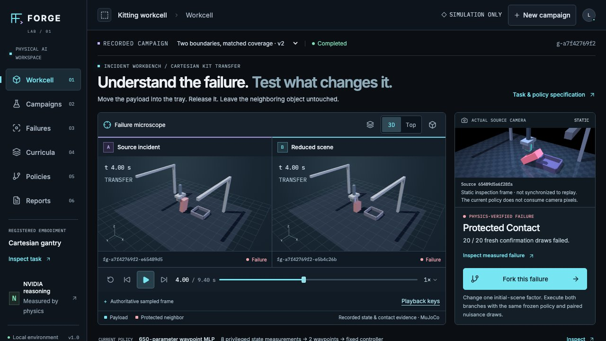

# FORGE

A local reliability workbench for a simulated robot policy. Replay an incident, fork one scene condition under the same checkpoint, and export an executable regression test. The underlying investigation also discovers failures, reduces them, collects successful corrections and trains actual weights.

FORGE uses real MuJoCo contact physics and a compact learned waypoint policy for an original Cartesian gantry. NVIDIA Nemotron Ultra on Nebius Token Factory proposed a reviewed scene intervention that was executed on 20 fresh paired reset draws. Fireworks Ultra and Together Super VL support the retained development investigation. The physics oracle decides outcomes. A pinned GR00T N1.7 / LIBERO worker package is included; its GPU execution and training remain pending.



More actual local views: [curriculum provenance](docs/screenshots/curriculum.png) and [policy comparison](docs/screenshots/policy-comparison.png).

## Run locally

Tested on macOS arm64, Python 3.11 and Node 22. The application stays on loopback ports 4401/4402.

```sh
python3.11 -m venv .venv
.venv/bin/python -m pip install -r requirements.txt
npm ci
npm run build
.venv/bin/python scripts/import_recorded_sample.py
.venv/bin/python scripts/import_incident_recording.py
npm start
```

Open [FORGE](http://127.0.0.1:4401). The [included recordings](evidence/README.md) contain actual campaigns and the completed incident diagnostic, with immutable physics, weights, NVIDIA receipts and evaluation evidence. Both imports make no network, physics or training calls. The starter requires an empty data store or an identical previous import; the incident add-on requires its exact parent/source/checkpoint and refuses conflicting local work. Runtime data lives in ignored `data/`.

For a short walkthrough using only saved evidence, follow the [recorded demo guide](docs/DEMO.md).

The demonstrated height intervention produced **20/20 paired rescues** under the frozen base checkpoint, with a conservative 95% difference interval of +60.65 to +100 percentage points. This is a diagnostic scene change, not learned policy improvement. The original registered comparison remains **do not promote**: minimized 297/300 shifted successes versus 300/300 for both random and source correction comparators.

To build a new base locally instead of importing a recording:

```sh
.venv/bin/python scripts/bootstrap.py
```

That command executes 40 real expert episodes and trains the base. Start a campaign in the interface to run the full investigation. The interface shows genuine progress and preserves completed evidence on interruption.

## Live development inference

For a new model-guided campaign, add `FIREWORKS_AI_API_KEY` and `TOGETHER_AI_API_KEY` to a `.env` in this repository's parent directory. `.env.example` lists names only. The API reads that file server-side; credentials never enter the frontend, evidence exports or checkpoints. Do not overwrite another project's existing parent `.env`.

The exact development routes are Fireworks `accounts/fireworks/models/nemotron-3-ultra-nvfp4` and Together `nvidia/NVIDIA-Nemotron-3.5-Super-VL`. The explicit intervention-planning CLI also supports Nebius `nvidia/Nemotron-3-Ultra-550b-a55b` through the qualified regional endpoint, using server-side `NEBIUS_API_KEY`. No silent provider/model fallback or automatic retry is used. Authored simulation measurements and render frames are sent for those explicit purposes. Offline recording inspection and frozen-policy reproduction need no keys. See the [intervention workflow and retained rejected responses](docs/incident-workbench.md).

## Inspect the complete loop

1. **Workcell / Failures:** scene-first synchronized replay, an actual inspection camera, controlled initial-scene forks, accepted planner rationale, paired uncertainty, cancellation/history and executable incident exports. The original reduction ladder and telemetry remain available.
2. **Campaigns:** bounded real coverage and model-ranked trials, immutable configurations and operational history.
3. **Curricula:** successful expert lineage, two measured failure clusters, matched source/minimized pairs and excluded evaluation regions.
4. **Policies:** real checkpoints, training losses, paired rescues/regressions, nomination provenance and a fresh paired condition challenge without retraining.
5. **Reports:** development history and independently registered confirmation, explicit uncertainty, promotion gates and a portable evidence export.

The first local-jitter curriculum did not beat the comparators. Its negative summary and original source/archive digests are retained in the portable starter; the full historical ZIP remains on the development workstation. The starter includes complete v2 and final evidence plus the separately labeled seed-404 reproduction. No green result is manufactured when a gate fails.

## Verify and reproduce

```sh
npm test
npm run typecheck
npm run build
npm run test:ui
```

The normal Python tests are offline. Browser QA uses the local server and Playwright Chromium; install it once with `npx playwright install chromium` if it is not already cached. A downloaded evidence ZIP includes checksums, frozen sources, policies and data:

```sh
python scripts/reproduce.py --bundle /path/to/extracted/export --verify
python scripts/reproduce.py --bundle /path/to/extracted/export --rerun-sample
python scripts/reproduce.py --bundle /path/to/extracted/export --rerun-demo
```

See [methodology](docs/methodology.md), [validation record](docs/validation.md), [runtime and reproduction](docs/runtime-and-reproduction.md), [API contract](docs/api-contract.md) and [engine contract](engine/README.md). The separate registered-evaluation CLI accepts an independently frozen manifest; it does not generate a convenient final test or retrain policies.

The small [incident test ZIP](evidence/nebius-incident-test.zip) is independently executable outside this checkout, including against another compatible checkpoint:

```sh
python /path/to/extracted-incident/scripts/incident_reproduce.py --bundle /path/to/extracted-incident --verify
python /path/to/extracted-incident/scripts/incident_reproduce.py --bundle /path/to/extracted-incident --rerun --all-pairs
python /path/to/extracted-incident/scripts/incident_reproduce.py --bundle /path/to/extracted-incident --rerun --checkpoint /path/to/compatible.json
```

See the [pinned GR00T/LIBERO qualification package](docs/groot-worker-qualification.md) for the exact source/checkpoint/embodiment contracts and future GPU launch commands. Its seven pending gates remain visible in the application. The existing camera is an inspection view; the current gantry policy receives eight instrumented state values and does not perform visual inference.

## Implementation and licensing

React/TypeScript and a lazy Three.js replay sit above a Python/FastAPI control plane, SQLite metadata and SHA-256-addressed evidence. Workers run in owned local process groups. Pausing happens at an episode boundary; cancellation confirms local termination. A late worker cannot commit across a generation fence. Partial attempts are not task outcomes.

Original code, gantry geometry and mark are MIT-licensed. MuJoCo is Apache-2.0. Self-hosted Inter and IBM Plex Mono retain their font licenses under `public/`. Dependency licenses remain with their respective packages. Private plans, secrets, runtime databases, virtual environments and build outputs are excluded from version control and scientific exports.
